<div align="center">

# WonderMaker ZR Ultra / Ultra-S: Fluidd Toolheads panel, for the ACE Pro or without it

**Use an Anycubic ACE Pro as the filament feeder and dryer of a WonderMaker ZR Ultra, and control it from the WonderMaker Toolheads card in Fluidd. No ACE Pro? The panel and the endless-spool option work without it.**
One installer, for WonderMaker's own Klipper / Moonraker / Fluidd.
With an ACE: one unit for T0–T3, slot N → hub inlet N → toolhead N.

[](https://www.gnu.org/licenses/gpl-3.0)
[](https://www.python.org/)
[](fluidd/)
[](#6-first-tests-on-the-printer)

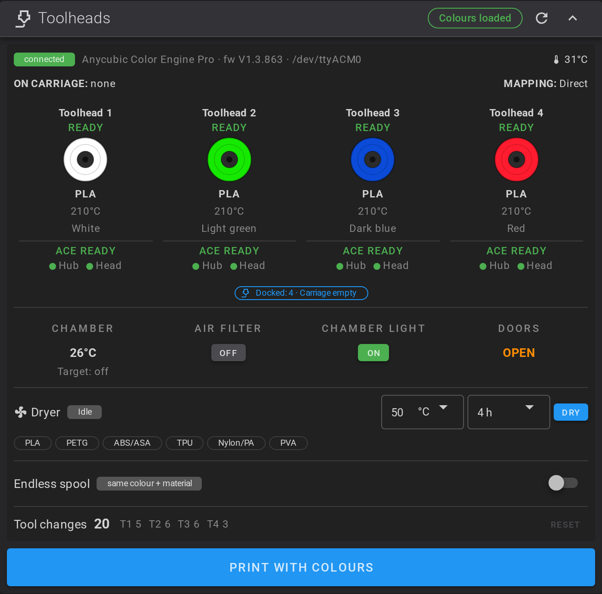

</div>

---

> **The ACE Pro is not an MMU here.** The WonderMaker ZR Ultra has four toolheads that do the switching. The ACE Pro in this project is used **only to load and unload the filament and to dry it**.

> **Status:** tested on a WonderMaker ZR Ultra-S printer with an ACE Pro (Fluidd panel, ACE driver, loading and unloading, printing, calibration macros), and with a simulated printer. It still needs a little tweaking, and other setups may differ. Use at your own risk, see the [disclaimer](#disclaimer-use-at-your-own-risk).

## Quick start

The idea: this adds to WonderMaker's own Klipper and Fluidd. It adds config files, an ACE driver and a new Toolheads card; it never replaces WonderMaker's files and never flashes anything.

> **Running Klipper on the original WonderMaker screen board (no Raspberry Pi)?** It works, but the board has **no `git`**, its clock is often wrong, and its apt sources point to a Debian archive, so `sudo apt-get install -y git` fails. Follow [3.2a](#32a-the-factory-screen-board-no-git-old-clock-archived-apt) first: it fixes the clock and apt, or lets you download this repository with `curl` and no git at all. The ACE also needs a free USB port on that board (the main board already uses one), or a powered hub. This has not been run on the factory board yet.

1. **Have WonderMaker's Klipper running on the machine** (the Raspberry Pi set up with [wm-ultra-rpi](https://github.com/ducati1198/wm-ultra-rpi), or the original board) and log in over SSH as `t13dp`. If `git` is missing (the factory screen board has none), see [3.2a](#32a-the-factory-screen-board-no-git-old-clock-archived-apt).
2. **Run the installer:**

   ```bash
   cd ~ && git clone https://github.com/ducati1198/wm-ultra-fluidd-acepro-panel
   cd wm-ultra-fluidd-acepro-panel && chmod +x installer.sh && ./installer.sh
   ```

   This opens the installer menu. Press **1** to install:

   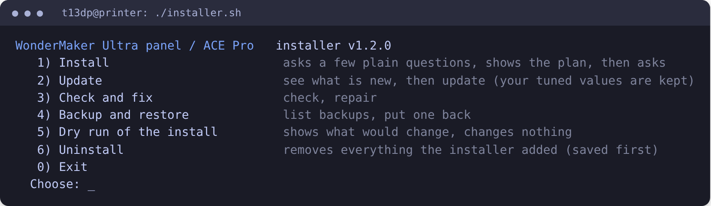

   Update opens a second page. `1) See what is new` (reads GitHub, changes nothing) and `2) Update now` (downloads the newest files, then applies them). Backup and restore has `1) List my backups`, `2) Restore the newest backup`, `3) Restore a backup from the list`.

   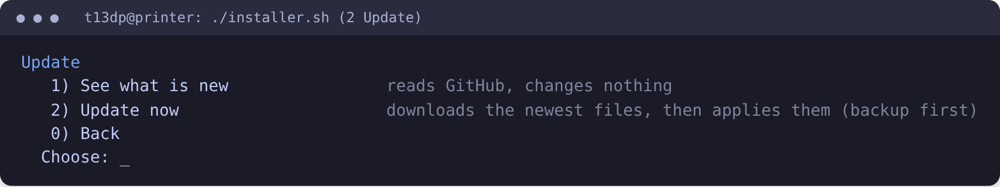

   It asks four questions: *Do you have an ACE Pro?* (**no is fine**), auto-load, endless spool, and the Fluidd panel. It shows what it will change and saves a backup first.
3. **Restart Klipper and hard-refresh the browser** (Ctrl/Cmd+Shift+R). *You should see the Toolheads card* with your four toolheads (and the ACE parts if you have an ACE).

   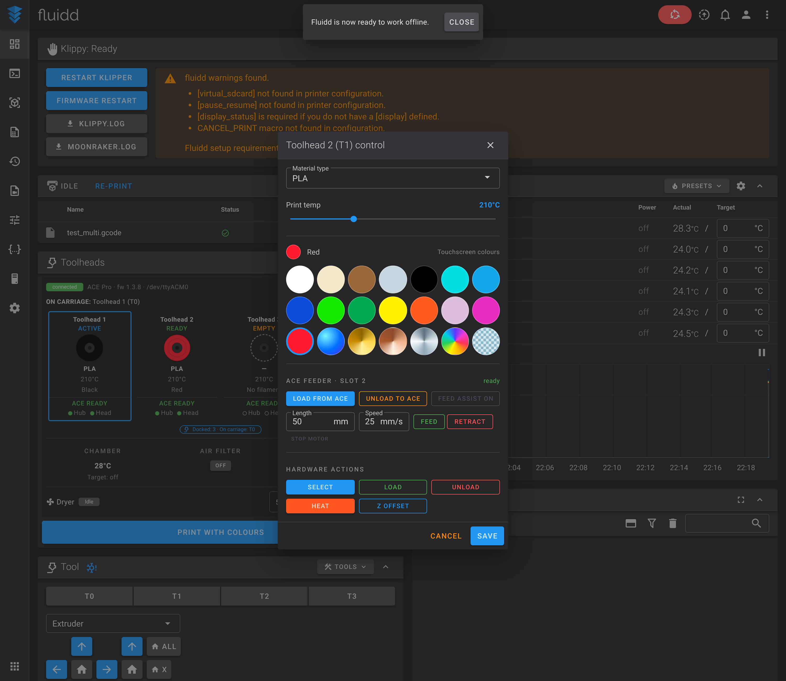

Optional: [pick toolheads inside OrcaSlicer](#install-the-orcaslicer-plugin-optional-works-without-an-ace-pro).

## Everyday cheat sheet

Run these in `~/wm-ultra-fluidd-acepro-panel`.

| I want to... | Run | What happens to my data |
|---|---|---|
| **Check** for problems | `./installer.sh --check` | Changes nothing |
| **Update** to the latest version | `./installer.sh` then **2 Update > 2 Update now** (or `git pull && ./installer.sh --update`) | Your tuned distances and speeds are kept |
| **Repair** (driver links, include lines) | `./installer.sh --repair` | Your tuned values are kept |
| **Back up** | automatic | Every install and update first saves the files it touches to `~/acepro-backup/wm-<date>` |
| **Undo** the last install or update | `./installer.sh --undo` | Puts back the files saved before it, including the old Fluidd |
| **Uninstall** | `./installer.sh --uninstall` | Removes what was added and, if you agree, puts the original Fluidd back (saved first, so `--undo` brings it back). WonderMaker's files are never touched. |
| **Preview** | `./installer.sh --dry-run` | Changes nothing |

More options: [3.2](#32-one-command-installer). Safety: a running or paused print stops the installer, it never flashes a board, and it never starts Klipper by itself.

## How it works

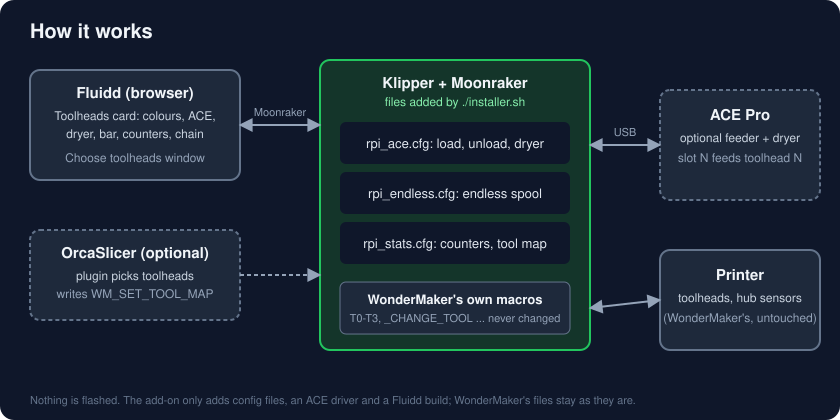

1. The **Toolheads card** in Fluidd shows your four toolheads and sends commands through Moonraker.
2. The commands call **macros in three config files** this installer adds (`wm_ace.cfg`, `wm_endless.cfg`, `wm_stats.cfg`). They sit on top of WonderMaker's own macros and call them; none of WonderMaker's macros is replaced.
3. With an **ACE Pro**, the ACE driver feeds slot N to toolhead N, using WonderMaker's own hub and toolhead sensors to know when to stop. Without one, the ACE parts stay hidden.
4. The **OrcaSlicer plugin** (optional) writes a `WM_SET_TOOL_MAP` line into the G-code so the print starts with the toolheads you picked.
5. Everything is **undoable**: the installer saves what it touches and `--undo` puts it back.

## If something goes wrong

| What you see | What to do |
|---|---|
| Klipper stops with "Unknown config object 'save_variables'" | You installed version 0.2.0: `git pull && ./installer.sh --update`. |
| "Unknown command WM_SET_TOOL_MAP" | `git pull && ./installer.sh --update`, then restart Klipper. |
| No ACE parts in the card | Normal without an ACE. With one: restart Klipper, check USB and the ACE power, hard-refresh. |
| Not sure what is wrong | `./installer.sh --check` lists problems. |

More in [Troubleshooting](#10-troubleshooting).

---

## Contents

- [Quick start](#quick-start) · [Everyday cheat sheet](#everyday-cheat-sheet) · [How it works](#how-it-works) · [If something goes wrong](#if-something-goes-wrong)

Details:

0. [Disclaimer: use at your own risk](#disclaimer-use-at-your-own-risk)
1. [What you get](#1-what-you-get)
2. [Hardware and wiring](#2-hardware-and-wiring)
3. [Install](#3-install)
4. [Configure](#4-configure)
5. [Fluidd Toolheads + ACE panel](#5-fluidd-toolheads--ace-panel) (including the [OrcaSlicer plugin](#install-the-orcaslicer-plugin-optional-works-without-an-ace-pro))
6. [First tests on the printer](#6-first-tests-on-the-printer)
7. [Everyday use and commands](#7-everyday-use-and-commands)
8. [Endless spool (experimental)](#8-endless-spool-experimental)
9. [Update, undo and uninstall](#9-update-undo-and-uninstall)
10. [Troubleshooting](#10-troubleshooting)
11. [Repository layout](#11-repository-layout)
12. [Credits and license](#12-credits-and-license)

---

## Disclaimer: use at your own risk

This project is provided **"as is"**, without warranty of any kind (see also the GPL v3 licence, sections 15 and 16).

- **Use it at your own risk.** You are responsible for what runs on your printer.
- **I am not responsible for any damage** to your printer, ACE Pro, electronics, hotend, prints or other property, or for any injury, fire or loss, caused by these files, the installer or the instructions.
- **It has been tested on one printer: a WonderMaker ZR Ultra-S with an ACE Pro** (installer, Fluidd panel, ACE driver, loading and unloading, printing, calibration macros), and with a simulated printer. Your printer, firmware or ACE may behave differently, so test in small steps. Section 6 lists what is still unverified.
- **Test in small steps**, with the printer empty, your hand near the emergency stop. Never leave a new setup unattended.
- Back up your config first. The installer makes backups and supports `--undo`, but you are responsible for keeping your own copies.
- This project is not made by or affiliated with WonderMaker, Anycubic or any other manufacturer. Product names belong to their owners.

> **No firmware is touched.** Nothing in this project flashes the main board, the toolhead boards or the hub board, and the installer never starts Klipper by itself.

---

## 1. What you get

| | |
|---|---|
| **Works without an ACE Pro** | Say no to the ACE question and you get the WonderMaker Toolheads panel and the endless-spool option only. Every ACE element stays hidden. Add the ACE later by running the installer again. |
| **ACE Pro as feeder** | `ACE_WM_LOAD T=n` feeds slot n to the hub inlet (fast), then to the toolhead sensor (slow). WonderMaker's own insert routine then heats and loads the filament. |
| **Uses WonderMaker's own sensors** | The hub sensor `path_N` stops the fast feed, the toolhead sensor `filament<N>` stops the slow feed. No new sensors needed. |
| **Unload** | `ACE_WM_UNLOAD T=n` runs WonderMaker's `UNLOAD_FILAMENT`, then the ACE pulls the filament back until `path_N` clears and into the ACE. |
| **Auto-load** | Put a spool into an ACE slot and it loads to the matching toolhead (switch off with `ACE_WM_AUTO ENABLE=0`). |
| **Feed assist** | Follows the active toolhead while printing. |
| **Dryer** | Start and stop from Fluidd, six material presets (PLA, PETG, ABS/ASA, TPU, Nylon/PA, PVA). Max 65 °C. |
| **Filament mapping at print start** | "Choose toolheads" window: opens only when a colour or material does not match a loaded toolhead, otherwise it just prints. |
| **One Fluidd card** | Everything sits in the WonderMaker **Toolheads** card, in the look of the ACE Pro card from [acepro-any-klipper](https://github.com/ducati1198/acepro-any-klipper). No separate ACE panel. |
| **Nothing replaced** | WonderMaker's `T0`…`T3`, `PAUSE`, `RESUME`, `LOAD_FILAMENT`, `UNLOAD_FILAMENT` stay as they are. The ACE driver is told not to create its own `T0`…`T7`. |
| **Endless spool (experimental)** | Off by default. When a head runs out the print pauses, and the card offers a spare head with the same colour and material. WonderMaker has no endless spool from the factory (section 8). |
| **Your own endless-spool chain** | In each toolhead's dialog: "If this spool runs out, take over with Toolhead N, then M". The chain is tried first, then the same colour and material (section 8). Not yet tested on a printer. |
| **Tool-change progress bar** | A bar in the card while WonderMaker changes tools (lifting, putting the old head back, locking the new one), read from WonderMaker's own flag and the dock sensors. Not yet tested on a printer. |
| **Counters** | Tool changes in total and per toolhead, with a Reset button. Not yet tested on a printer. |
| **OrcaSlicer plugin** | Pick the toolhead for each filament inside Orca; written into the G-code as `WM_SET_TOOL_MAP` ([`orca_plugin/`](orca_plugin/INSTALL.md)). |
| **Orca filament sync** | With an ACE, the slots are published to Moonraker's `lane_data` so Orca's "sync filament from printer" can see them. Not yet tested. |
| **Safe installer** | Asks plain questions, shows what changes, backs up first, `--undo`, `--check`, `--dry-run`, tests. |

<div align="center">
<br>
<em>The toolhead dialog with the endless-spool chain and the "ACE feeder · slot N" section (demo data).</em><br><br>
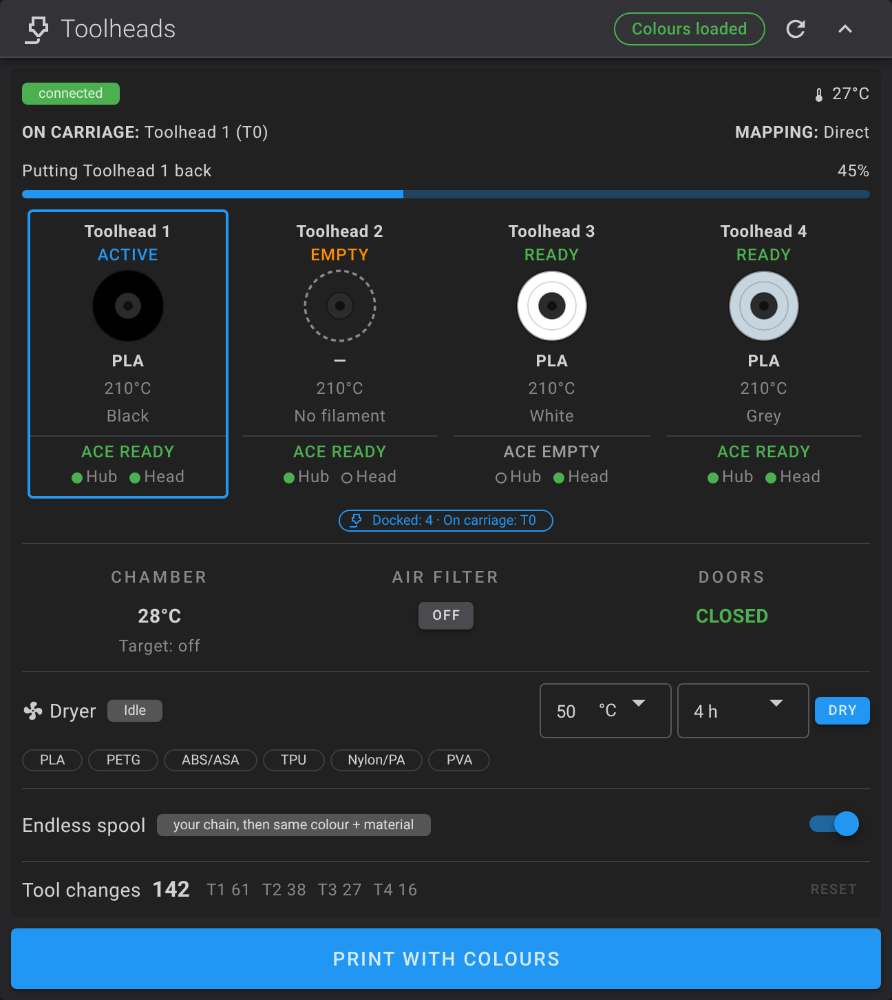<br>
<em>The tool-change progress bar and the counters (demo data).</em>
</div>

If no ACE is installed, the card looks exactly like the plain WonderMaker Toolheads card: every ACE element is hidden until Klipper reports an ACE (section 5).

---

## 2. Hardware and wiring

What you need to run an ACE Pro on a WonderMaker ZR Ultra / Ultra-S, and how to connect it by USB. (The same guide is also in [`docs/HARDWARE.md`](docs/HARDWARE.md).) **No ACE Pro? Skip this section and go to [Install](#3-install).**

> The connector pinouts below come from the Kobra-S1/ACEPRO documentation and community adapter builds. They are not re-measured on every unit, so **check your adapter with a multimeter before plugging it in** (section 2.4).

### 2.1 What you need

| Part | Required | Notes |
|---|---|---|
| WonderMaker ZR Ultra or Ultra-S with WonderMaker's own Klipper, Moonraker and Fluidd | Yes | The installer looks for WonderMaker's `zru-s.cfg`, `_CHANGE_TOOL`, `UNLOAD_FILAMENT` and the hub sensor `path_0`, and refuses to run on anything else. |
| 1 Anycubic Color Engine Pro (first generation) | Only for the ACE parts | One unit covers all four toolheads (T0–T3). |
| USB cable or adapter for the ACE | Only for the ACE parts | Section 2.3 shows how to build one. |
| 4 PTFE tubes, ACE → filament hub | Only for the ACE parts | Slot 1 → hub inlet 1 → T0, slot 2 → inlet 2 → T1, slot 3 → inlet 3 → T2, slot 4 → inlet 4 → T3. |
| WonderMaker's hub sensors `path_0`…`path_3` and toolhead sensors `filament0`…`filament3` | Already on the printer | They stop the feed. No extra sensor is needed. No RDM sensor, encoder, cutter or poop basket is used. |
| USB port on the Klipper host | Only for the ACE parts | Use a powered hub if the ports are weak. |

The WonderMaker hub is passive (no motor). The ACE pushes and pulls the filament between the ACE and the hub; the toolhead extruder does the rest. The sensors are WonderMaker's own, set in its config; nothing about them is changed.

| Sensor | Where | Used for |
|---|---|---|
| `path_0` … `path_3` | WonderMaker filament hub (HUB MCU, pins `!HUB:PC13/PB12/PA2/PA3`) | The fast feed stops when the filament reaches the hub; during unload the ACE retracts until it clears. |
| `filament0` … `filament3` | Each toolhead | The slow feed stops when the filament reaches the toolhead; WonderMaker's own insert routine then takes over. |

### 2.2 Which ACE do you have?

| Unit | What the 4-pin connector carries | What to use |
|---|---|---|
| **ACE Pro** (first generation) | Native USB data | A plain USB-A adapter (below). It appears in Linux as `/dev/ttyACM*`. |
| **ACE 2 Pro** | RS-485, not USB | Not tested here (see below). It needs the RS485-to-USB conversion cable from Anycubic's ACE 2 kit; a home-made USB cable will not work. |

The driver detects which protocol a unit speaks (`protocol: auto` in `wm_ace_driver.cfg`). The rest of this section is about the first-generation ACE Pro.


#### ACE 2 Pro: what is known (not tested in this project)

- **It talks RS-485, not USB.** Use Anycubic's own [ACE 2 PRO USB to RS485 Signal Cable](https://ca.anycubic.com/products/ace-2-pro-usb-to-rs485-signal-cable) (the store lists it for the Kobra S1 ACE 2 Pro, Kobra 3, Kobra 3 V2, Kobra 3 Max and Kobra 3 Max V2). Do not build one yourself: no wiring or pinout is published. Anycubic's wiki has a page called [compatibility guide for other models](https://wiki.anycubic.com/en/fdm-3d-printer/ace-2-pro/compatibility-guide-for-other-models).
- **Use the right cable.** The upstream [Kobra-S1/ACEPRO](https://github.com/Kobra-S1/ACEPRO) project, which this driver comes from, says you need the KS1/K3 ACE 2 conversion cable, and that a Kobra-X or KS1-Max cable will not work on a KS1, K3 or Raspberry Pi.
- **Driver.** The ACE driver here has an ACE 2 adapter (protobuf over a shared RS-485 bus, 230400 baud). `protocol: auto` picks the right one, and `protocol: ace2` forces it. Nobody has tried it with the WonderMaker Ultra yet.
- **Installer.** Its "do I see an ACE on USB" check looks for `anycubic`, `ace` or `28e9` in the device list. An RS-485 adapter may be listed under another name. The installer then only prints a warning and carries on.

If you try it, please report what `lsusb` and the driver log show.

### 2.3 USB adapter for the ACE Pro

<div align="center">
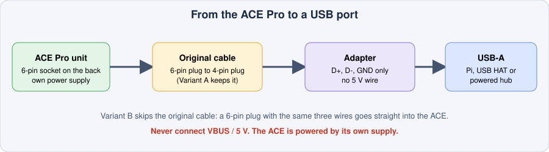
</div>

Only **three wires** are used: **D+, D- and GND**. Do **not** connect VBUS (5 V). The ACE has its own power supply, and a second 5 V source on the data cable can damage the host or the unit.

The stock cable has a 6-pin plug for the ACE's socket and a 4-pin plug that normally goes into an Anycubic printer. You can adapt either end:

| | Variant A: adapt the printer end | Variant B: adapt the ACE end |
|---|---|---|
| Original cable | Kept as it is | Not used |
| You build | A 4-pin socket to USB-A adapter | A 6-pin plug to USB-A cable |
| Donor part | A 4-pin ACE extension cable (cut one end off) | A 6-pin plug or pigtail |
| Good if | You want to keep the original cable and be able to go back to it | You want the shortest path or a tidy back cover |

<div align="center">
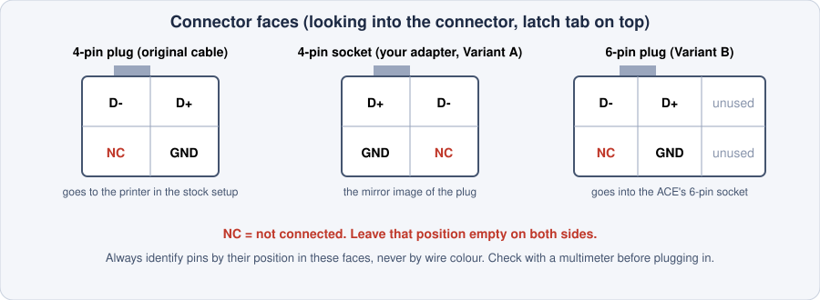
</div>

| ACE signal | USB-A pin |
|---|---|
| D+ | 3 |
| D- | 2 |
| GND | 4 |
| NC (not connected) | 1 (VBUS), left unconnected |

- The plug and the socket faces are mirror images of each other. That is normal for connectors that mate.
- Use the **position** in the diagram to find each pin. Wire colours differ between cable makers.
- The 6-pin plug has the same 2×2 signal block in two columns, plus a third column with no contacts.

### 2.4 Check before you plug in

With a multimeter (no ACE connected, nothing powered):

1. **Continuity:** D+ to USB pin 3, D- to USB pin 2, GND to USB pin 4.
2. **No shorts:** D+ to D-, D+ to GND and D- to GND must not beep.
3. **VBUS:** USB pin 1 must not be connected to anything on the ACE side.

Then plug it in, power the ACE and, on the machine that runs Klipper:

```bash
ls /dev/serial/by-id/          # the ACE should be listed
```

Restart Klipper and run `ACE_GET_STATUS`. The ACE chip in the Fluidd Toolheads card then shows "connected".

---

## 3. Install

### 3.1 Requirements

- WonderMaker's Klipper and Moonraker with its `zru-s.cfg` config, and Fluidd (optional, for the panel). Python 3.9 or newer in Klipper's environment (`~/klippy-env`), with `pyserial` for the ACE.
- **With an ACE:** one ACE Pro connected by USB (a powered hub is fine), and the tubes from section 2.1. **Without an ACE:** nothing else.
- No print running.
- SSH access to the machine that runs Klipper (user `t13dp`, default password in 3.2).
- The printer's main board does **not** have to be connected to run the installer. Klipper can stay stopped.

### 3.2 One-command installer

Log in to the printer's Klipper host over SSH first (Windows, macOS and Linux all have `ssh` in the terminal):

```bash
ssh t13dp@<printer-ip>        # user: t13dp   default password: TM88888
```

If you changed the password, use yours. Find `<printer-ip>` in your router's device list, or use the hostname if you know it. The first time, answer `yes` to the fingerprint question.

Then, on the printer:

```bash
sudo apt-get update
sudo apt-get install -y git
cd ~
git clone https://github.com/ducati1198/wm-ultra-fluidd-acepro-panel
cd wm-ultra-fluidd-acepro-panel
chmod +x installer.sh
./installer.sh
```

> **"destination path 'wm-ultra-fluidd-acepro-panel' already exists"?** You already downloaded it once. Do not clone again. Update the folder instead:
>
> ```bash
> cd ~/wm-ultra-fluidd-acepro-panel
> ./installer.sh --get-latest
> ```
>
> That only gets the newest files from GitHub and changes nothing else. To also apply the update to the printer, run `./installer.sh --update` afterwards (optional).
>
> If it complains about local changes, see [section 9](#9-update-undo-and-uninstall).

The installer asks a few plain questions, shows exactly what it will change, and only then does it. It saves a backup first, so `./installer.sh --undo` puts everything back.

**The questions** (each has a one-line reason and a safe default):

1. Do you have an **Anycubic ACE Pro** to connect? (No gives you the panel and the endless-spool option only.)
2. With an ACE: load a spool **automatically** when you put it into a slot?
3. Add the experimental **endless-spool** macros? (Switched off until you turn them on in Fluidd.)
4. Install the **Fluidd panel**? (Your Fluidd folder is saved first.)

**What it does:**

1. Checks that this is a WonderMaker ZR Ultra config and that no print is running.
2. With an ACE: checks that the driver compiles and that `pyserial` is available, and looks for the ACE on USB (a warning, not a stop, if it is not there yet).
3. With an ACE: links the ACE driver (`extras/ace/`), `virtual_pins` and the ACE temperature sensor into Klipper's `extras` folder.
4. Copies the config files into your config folder and adds the `[include …]` lines to `printer.cfg` in one block just above the SAVE_CONFIG block, after `[save_variables]` (the ACE driver reads `[save_variables]` while it loads, so the lines must come after it). `wm_stats.cfg` (counters and the tool map) is always added. No WonderMaker file is edited.
5. Installs the Fluidd panel if you chose it (your `config.json` is kept; the old folder is saved).
6. Saves everything it touched in `~/acepro-backup/wm-<date>`.
7. Asks once whether to restart Klipper (default no, and only if Klipper is running).
8. Prints your next steps.

**More commands:**

| Command | What it does |
|---|---|
| `./installer.sh` (or `--menu`) | Open the numbered menu (at a terminal). `--install` skips it. |
| `./installer.sh --check-updates` | See what is new on GitHub. Downloads nothing. |
| `./installer.sh --get-latest` | Download the newest installer files (git pull, or a tarball when there is no git). Then run `--update`. |
| `./installer.sh --update` | Update the files. Your tuned values (distances, speeds) are kept. |
| `./installer.sh --check` | Look for problems. Changes nothing. |
| `./installer.sh --repair` | Restore the driver links and the include lines. |
| `./installer.sh --undo` | Put back the files saved before the last install. |
| `./installer.sh --uninstall` | Remove everything the installer added (saved first, so `--undo` brings it back). |
| `./installer.sh --dry-run` | Go through the questions and show what would change. Changes nothing. |
| `./installer.sh --fluidd-categories` | Sorts the printer's macros into Fluidd's coloured categories. Also done at the end of an install and update. See section 3.5. |
| `./installer.sh --doctor` | Finds problems (printer.cfg, disk space, version, driver links, config files, include lines, the Fluidd panel) and offers a fix for each; asks first. |
| `./installer.sh --support-bundle` | Writes `~/ace-support-<date>.tgz` with a system report (including USB tree, serial ports and kernel USB messages), config files and log ends. Passwords, tokens, Wi-Fi names, private IP and MAC addresses are removed. |
| `./installer.sh --free-space` | Lists what is safe to erase (sizes and a warning for each), erases only what you pick and confirm. Also offered by the install when space is short (about 300 MB needed). |
| `./installer.sh --fix-clock` | Original WonderMaker screen board only: turn on automatic time sync (NTP) and fix apt (Debian archive). Skipped on other machines. |
| `./installer.sh --klipper-dir DIR` / `--config-dir DIR` | Use another Klipper folder or config folder than the default (`~/klipper`, `~/printer_data/config`). |
| `./installer.sh --version` | Print the installer version. |

**Safety checks the installer makes first:**

- It **stops if a print is running or paused** (there is no override). `--check` and `--dry-run` still work.
- It **stops if the config is not a WonderMaker ZR Ultra / Ultra-S config.**
- It warns, and carries on, if it **sees no ACE on USB**.
- It **never flashes any board and never starts Klipper by itself.**

### 3.2a The factory screen board: no git, old clock, archived apt

If Klipper runs on the **original WonderMaker screen board**, `git` is not installed and `sudo apt-get install -y git` fails: Debian 11 was moved to an archive and the board's clock is often wrong, so even HTTPS to GitHub can fail. Log in over SSH as `t13dp` and do this once. You can skip steps 1 to 3 if you use the download in step 4 and `curl` already works.

```bash
# 1. Set the date and time (HTTPS to GitHub fails if the clock is wrong). Use your own date/time, UTC:
date                                   # check it first
sudo date -s "2026-11-03 18:00:00"     # example only: put today's date and time here
# 2. Point apt at the Debian archive and stop it rejecting old package lists
sudo cp /etc/apt/sources.list /etc/apt/sources.list.orig
sudo sed -i -E 's#https?://[^ /]+/debian-security#http://archive.debian.org/debian-security#; t; s#https?://[^ /]+/debian/?#http://archive.debian.org/debian/#' /etc/apt/sources.list
printf 'Acquire::Check-Valid-Until "false";\nAcquire::Check-Date "false";\n' | sudo tee /etc/apt/apt.conf.d/99no-check-valid-until
# 3. Now this works
sudo apt-get update
sudo apt-get install -y git
```

**The installer can do steps 1 and 2 for you** (only on this factory board; it is skipped on a Raspberry Pi or any other machine): it asks once to turn on automatic time sync (NTP) and to point apt at the Debian archive. Run it alone with `./installer.sh --fix-clock`, or from the menu: 3 Check and fix > Fix the clock and apt. If you cannot download this repository yet because the clock is wrong, use the manual steps above first.

Never run `apt upgrade` or `apt full-upgrade` on this board: it can replace WonderMaker's held X server and break the screen. `apt-get install` of one package is fine.

Then get this repository in one of two ways:

**Option A: no git needed** (works even if apt is broken)

```bash
cd ~
curl -fsSL https://codeload.github.com/ducati1198/wm-ultra-fluidd-acepro-panel/tar.gz/refs/heads/main | tar xz
cd wm-ultra-fluidd-acepro-panel-main
chmod +x installer.sh && ./installer.sh
```

**Option B: with git** (after steps 1 to 3 above)

```bash
cd ~
git clone https://github.com/ducati1198/wm-ultra-fluidd-acepro-panel
cd wm-ultra-fluidd-acepro-panel
chmod +x installer.sh && ./installer.sh
```

With Option A there is no `git pull`: to update, delete the old `wm-ultra-fluidd-acepro-panel-main` folder, download again as above, and run `./installer.sh --update`. Your settings and backups are not in that folder (they are in `~/printer_data` and `~/acepro-backup`), so deleting it loses nothing.

If the ACE does not show up on this board, check the free USB port first: the main board already uses one, so the ACE needs a second host port or a powered hub (`lsusb` shows what is connected).

### 3.3 Check `printer.cfg`

The installer adds these for you (the two ACE lines only with an ACE, the endless line only if you chose it, the stats line always). They sit in one block near the end of the file, above the `#*# SAVE_CONFIG` block and after `[save_variables]`, not next to `[include zru-s.cfg]`. Check they are there:

```ini
[include wm_ace_driver.cfg]
[include wm_ace.cfg]
[include wm_endless.cfg]
[include wm_stats.cfg]
```

Restart Klipper from Fluidd (FIRMWARE_RESTART) or:

```bash
sudo systemctl restart klipper
```

With an ACE, run `ACE_GET_STATUS` in the console. You should see the unit connected with its four slots.

### 3.4 Fluidd panel

Installed by the installer (step 5 above). Manual steps and building it yourself: [`fluidd/README.md`](fluidd/README.md).

> **After any install or update, hard-refresh the browser** so Fluidd loads the new files:
> Windows/Linux `Ctrl+Shift+R` · macOS `Cmd+Shift+R`.

---

## 4. Configure

**Hook lines in WonderMaker's files.** The installer adds three lines to each of `extruder0.cfg` … `extruder3.cfg` (inside `insert_gcode` of the tool head sensor): `_WM_ACE_HEAD T=n` as its first line, `_WM_ACE_GRAB T=n` just before `filament_insert`, and `_WM_ACE_HEAD_DONE T=n` just after `PARK_CURRENT_TOOL`. They do nothing unless the ACE is loading that tool. They are needed because WonderMaker's insert routine holds the G-code queue for about 70 seconds, so the ACE could not react in time otherwise. The installer saves a copy of each file first and leaves a file alone (with a warning) when its anchors are not found; `--repair` adds them again, `--check` / `--doctor` report them, `--uninstall` removes them (`scripts/ace_hooks.py`).

Everything you may want to tune is at the top of `~/printer_data/config/wm_ace.cfg` (`[gcode_macro _WM_ACE]`). `--update` keeps your values.

| Variable | Default | Meaning |
|---|---|---|
| `variable_hub_to_head_mm` | 900 | Hub inlet → toolhead sensor. Limit of the slow phase. **Measure your tubes.** |
| `variable_max_total_mm` | 4000 | Absolute safety limit for one load. |
| `variable_tail_mm` | 1800 | Retract distance after the hub sensor clears (hub → inside the ACE). |
| `variable_fast_speed` / `slow_speed` | 60 / 20 mm/s | ACE → hub / hub → toolhead. |
| `variable_retract_speed` | 50 mm/s | Unload. |
| `variable_fast_timeout_s` / `slow_timeout_s` | 90 / 60 | A load that takes longer stops with an error. |
| `variable_auto` | 1 | 1 = load automatically when a spool is put into a slot. |

Driver settings (`wm_ace_driver.cfg`): `ace_count: 1`, `register_tool_commands: False` (keeps WonderMaker's own `T0`…`T3`), `feed_speed`, `retract_speed`, `max_dryer_temperature: 65`, `moonraker_lane_sync_enabled: True` (publishes the ACE slots to Moonraker's `lane_data` for OrcaSlicer; set `False` to switch it off).

Endless spool settings (`wm_endless.cfg`): `variable_hop` (Z lift while heads are swapped, 4 mm), `variable_prime_mm` (20), `variable_prime_speed` (300).

---

## 5. Fluidd Toolheads + ACE panel

The ACE has no card of its own. It lives inside the WonderMaker **Toolheads** card:

- **ACE header:** connection state, temperature and humidity.
- **Per toolhead:** ACE slot state (ready / empty / loading / assist) and two sensor dots (hub `path_N`, head `filament<N>`).
- **Dryer row:** target temperature, duration, Dry / Stop, and six presets.
- **Endless spool row:** a switch, plus a banner and one-tap confirmation when a head runs out.
- **Toolhead dialog → "ACE feeder · slot N":** Load from ACE, Unload to ACE, Feed assist on/off, manual Feed / Retract with length and speed, Stop motor.

Everything ACE-related is **hidden** when Klipper has no ACE object (`ace_instance_0`). The endless-spool row is hidden when the `WM_ENDLESS_CONTINUE` macro does not exist. So you can install the panel before the ACE hardware.

### Choose toolheads (filament mapping)

When you press **Print** (file list) or **Re-print**, the panel looks at the file first:

- **Everything matches:** no window. The file prints at once, and a message tells you which toolhead each filament uses.
- **A colour or material does not match:** the **Choose toolheads** window opens. Each filament in the file shows its colour, material and weight, four toolhead buttons (colour + material of what is loaded), and a **Matches** / **Check** tag. One warning per filament explains the problem. You can pick another toolhead, **print anyway**, or cancel.

A toolhead counts as a match when its colour is the closest of WonderMaker's palette colours to the file's colour and the material fits (for example PLA on a PLA head). The suggestion keeps a filament on its own toolhead when that already matches; the rest get the closest loaded toolhead, each used once where possible.

<div align="center">
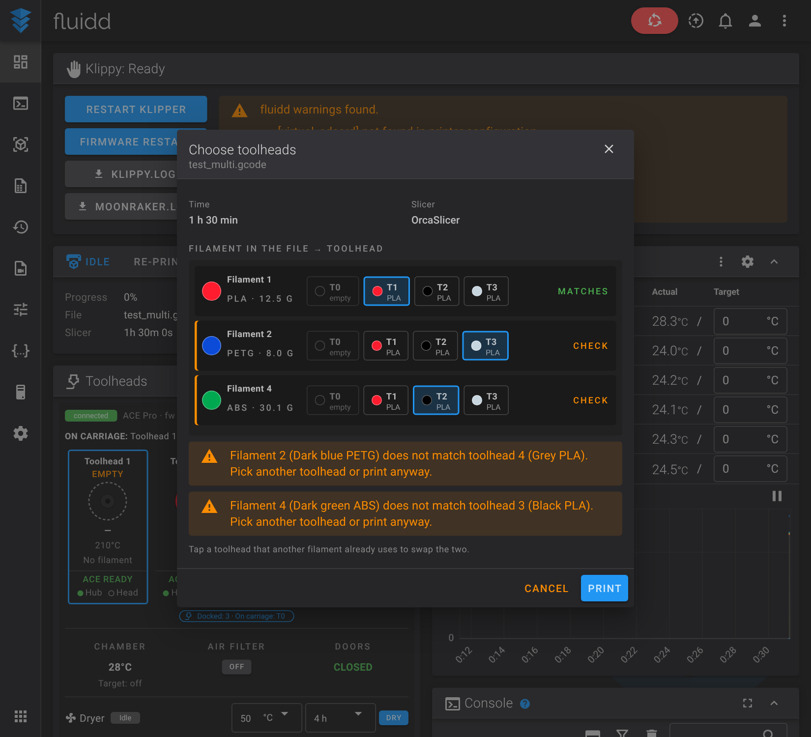<br>
<em>A file whose colours and materials do not match the loaded toolheads (demo data).</em>
</div>

- Tapping a toolhead that another filament already uses **swaps** the two.
- An **empty** toolhead blocks the print, because there is nothing to feed.
- **Print** saves the mapping to the printer (`box_modify_t0`…`t3`, the same variables WonderMaker's own tool changes read) and starts the print. The map applies to that print only; tools without a colour in the file are reset to direct.
- It works the same without an ACE Pro.
- The Toolheads card's own print button opens a file picker first, then this window.

### Tool-change bar, counters and the OrcaSlicer plugin

- **Tool-change bar.** While WonderMaker changes tools the card shows what it is doing (lifting Z, putting the old head back, locking the new one). It reads WonderMaker's own `changing_tool` flag and the dock sensors; no WonderMaker macro is changed or wrapped. The percentages are rough steps, not a measurement.
- **Counters.** `wm_stats.cfg` watches WonderMaker's `current_extruder` every 2 seconds and counts every change: in total and per toolhead (`wm_stat_changes`, `wm_stat_head0`…`3`). **Reset** (or `WM_STATS_RESET`) sets them to 0. Purged filament is not counted, because that would mean wrapping WonderMaker's purge macros.
- **OrcaSlicer plugin.** Choose the toolhead per filament inside Orca. Install steps are in the next section.

### Install the OrcaSlicer plugin (optional, works without an ACE Pro)

The plugin lets you pick, inside Orca, which toolhead prints each filament. When you send or export, it writes the choice at the top of the G-code, so the print needs no popup at start. It reads your four toolheads (colour, material, loaded or empty) from the printer, so an ACE Pro is not needed.

<div align="center">
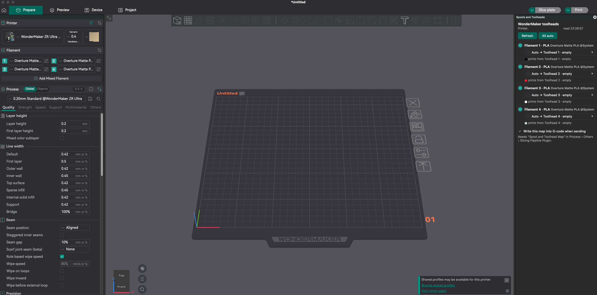
</div>

**On the printer (once):** run `./installer.sh` or `./installer.sh --update` from this repository. That installs `wm_stats.cfg`, which holds the `WM_SET_TOOL_MAP` macro the plugin calls. Then restart Klipper.

**In OrcaSlicer (once):**

1. Download the plugin file `spool_toolhead_mapper.py` from the [`orca_plugin/`](https://github.com/ducati1198/wm-ultra-fluidd-acepro-panel/tree/main/orca_plugin) folder (open the file, then use the download button; keep the `.py` name). The same plugin also works with an ACE Pro printer: it detects which printer it is talking to.
2. Open Orca's **Printer settings → Connection** and make sure the host is your printer's address, for example `192.168.0.50:7125`. The plugin uses it to read the toolheads.
3. Open **File → Plugins**, use the split button **Browse plugins → Install local plugin**, and pick `spool_toolhead_mapper.py`.
4. When Orca asks whether the plugin may connect to your printer, click **Yes**.
5. The plugin brings two parts, **Spools and Toolheads** (the panel) and **Spool and Toolhead Map** (the G-code step). If the Plugins window shows them disabled, enable both.
6. Switch Orca to **Advanced** mode. Open your **Process** settings → **Others** → **Slicing Pipeline Plugin**, add **Spool and Toolhead Map**, and save the process preset. Do this for each process preset you print with.
7. Restart Orca. The **Spools and Toolheads** panel docks on the right of the 3D view.

**Use it:** in the panel, each filament shows its best toolhead (**Auto**: same material, closest colour, each toolhead used once). Change a row to a specific toolhead or **As sliced**, then slice and use **Upload and Print**. The G-code gets a line like:

```
WM_SET_TOOL_MAP MAP=0:0,1:3,2:2,3:3 FILE="benchy.gcode" KEEP_EXISTING=1
```

Print tool T1 is then printed with toolhead 4 (the numbers in the macro start at 0). If you choose toolheads in Fluidd's **Choose toolheads** window for the same file, the Fluidd choice wins. More detail: [`orca_plugin/INSTALL.md`](orca_plugin/INSTALL.md).

### Dryer presets

| Preset | Temperature | Time |
|---|---|---|
| PLA | 45 °C | 4 h |
| PETG | 55 °C | 6 h |
| ABS / ASA | 65 °C | 6 h |
| TPU | 50 °C | 6 h |
| Nylon / PA | 65 °C | 8 h |
| PVA | 45 °C | 6 h |

The ACE tops out at 65 °C. The presets only fill in the fields; you press **Dry**.

The panel is Fluidd v1.37.7 plus WonderMaker's ZR Toolheads card and the ACE parts. The source changes are in [`fluidd/fluidd-v1.37.7-zr-ace.patch`](fluidd/fluidd-v1.37.7-zr-ace.patch).

---

## 6. First tests on the printer

Written for the day the printer is running again. Do them in this order, empty bed, hand near the stop button. Steps 2–8 are for an ACE Pro; without one, steps 1 and 9–11 apply.

1. `./installer.sh --check` → no problems. Restart Klipper once, read `~/printer_data/logs/klippy.log` for `[ace]` lines.
2. **Connection:** the ACE chip in the Toolheads card turns "connected". Temperature and humidity show.
3. **Dryer:** start the PLA preset for a few minutes, then Stop.
4. **Manual feed:** in the toolhead dialog, Feed 50 mm at speed 25, then Retract 50 mm. Check the direction and the Stop button.
5. **Sensor check:** push filament by hand to the hub and to the toolhead and watch the two dots.
6. **Measure the tubes** and set `variable_hub_to_head_mm` and `variable_tail_mm`.
7. `ACE_WM_LOAD T=0`, then `ACE_WM_UNLOAD T=0`, one head at a time (tried on all four heads).
8. Auto-load by inserting a spool, then feed assist during a short print.
9. Endless spool (section 8) only on a cheap print with you standing next to the printer. Set a chain first (toolhead dialog → "If this spool runs out") and check that the swap offer names the head you chose.
10. **Counters and bar:** do a manual tool change (`T1`, then `T0`) from the console. The counters in the card should go up by 2 and the progress bar should move and finish.
11. **OrcaSlicer plugin** (section 5): slice a two-colour file, send it, and check that the first lines of the G-code on the printer hold `WM_SET_TOOL_MAP`, and that the print uses the toolheads you picked.

### Tested on the printer (ACE Pro, ZR Ultra-S)

- The driver starts and talks to the ACE; `ACE_FEED` / `ACE_RETRACT` do not block, so the polling state machine can watch the sensors.
- The slot status field (`ready` / `empty`) is read correctly, and `ACE_STOP_FEED` / `ACE_STOP_RETRACT` are harmless when the ACE is idle.
- Load: the ACE feeds fast to the hub, creeps to the tool head sensor, stops, and feed assist turns on. Filament reached the nozzle (T2 confirmed; T0, T1 and T3 loaded).
- Unload on T0, T1, T2 and T3: the tool is picked up by itself, the extruder pulls the tip, the ACE retracts, and the slot ends up empty. Auto-load is held off for a while afterwards so the slot's empty-then-ready flicker does not start a new load.
- Tool head LEDs (`wm_tool_leds.cfg` in wm-ultra-rpi): blue with filament, red without.

### Still unverified (needs the printer)

- The short extruder grab push before WonderMaker's insert routine, and feed assist turning off when that routine is finished.
- How the formed tip looks (the ACE pulls the filament back, so it has not been inspected).
- The "filament tangled" warning that appears during some ACE moves, and the hub path sensors, which read "filament" even for empty slots (unload finishes on the ACE slot status instead).
- ACE USB stability over a long time (kernel `error -71` appeared before the cable was moved).
- What the head sensor `docked<N>` means on the real hardware.
- Tube lengths, speeds and the overshoot after a sensor trips.
- `ACE_STOP_FEED` / `ACE_STOP_RETRACT` are harmless when the ACE is idle.
- The whole endless-spool sequence (tool change while paused, hop, prime), and the chain choice.
- The tool-change bar: it assumes that a flip of a head's `docked<N>` sensor means the head was put back or taken, whichever way the sensor reads, and it reads WonderMaker's `changing_tool` flag. Both are untested on the real printer.
- The counters (they watch `current_extruder` every 2 seconds).
- Moonraker `lane_data` sync (`moonraker_lane_sync_enabled`).

---

## 7. Everyday use and commands

| Command | What it does |
|---|---|
| `ACE_WM_LOAD T=0..3` | Feed slot to hub and toolhead sensor. At the sensor the ACE stops, feed assist turns on, the extruder gear grabs the filament with a short push, WonderMaker's insert routine finishes the load, then feed assist turns off. |
| `ACE_WM_UNLOAD T=0..3` | Picks up the tool, forms a tip with the extruder alone (ACE idle, feed assist off), then the ACE pulls the filament back until its slot is empty. |
| `ACE_WM_RETRACT T=0..3` | Only the ACE part of an unload (after WonderMaker's `UNLOAD_FILAMENT`). |
| `ACE_WM_STOP` | Stop any feed or retract started by these macros. |
| `ACE_WM_AUTO ENABLE=1\|0` | Auto-load on spool insert. |
| `ACE_WM_DRY_START TEMP=55 DURATION=360` | Start drying (max 65 °C). |
| `ACE_WM_DRY_STOP` | Stop drying. |
| `WM_ENDLESS_SET ENABLE=1\|0` | Endless spool on / off (the Fluidd switch does the same). |
| `WM_ENDLESS_CHAIN_SET HEAD=0 CHAIN=2,1` | When head 0 runs out, take over with head 2, then head 1. Empty `CHAIN=` clears it. Heads are numbered 0–3. |
| `WM_ENDLESS_PLAN FROM= TO=` | Show what a swap would do; moves nothing. |
| `WM_SET_TOOL_MAP MAP=0:2,1:3 [FILE=] [KEEP_EXISTING=1]` | Print tool → toolhead for the next print (written by the OrcaSlicer plugin; Fluidd's choice wins for the same file with `KEEP_EXISTING=1`). |
| `WM_STATS_RESET` | Tool-change counters back to 0. |
| `ACE_FEED T= LENGTH= SPEED=` / `ACE_RETRACT …` | Manual moves (driver commands). |
| `ACE_ENABLE_FEED_ASSIST T=` / `ACE_DISABLE_FEED_ASSIST T=` | Feed assist on / off for one slot. |

Loads and unloads are refused while a print is running. Printing, colour mapping and tool changes stay exactly as WonderMaker made them.

---

## 8. Endless spool (experimental)

**WonderMaker has no endless spool from the factory.** Their config, macros and the touchscreen app (v1.0.26) only pause on runout, and the product page says the same: "Printing pauses when filament runs out or breaks." This add-on is mine, built around WonderMaker's pause and resume. It is off by default and does not need an ACE Pro.

How it works:

1. A head runs out → WonderMaker pauses the print (its normal behaviour).
2. The Toolheads card looks for a spare head that is loaded and not used by the running print. It tries **your chain** first (set it in the toolhead dialog under "If this spool runs out", or with `WM_ENDLESS_CHAIN_SET HEAD=0 CHAIN=2,1`), then any head with the same slot colour and material.
3. You tap **Swap & continue** and confirm. The macro `WM_ENDLESS_CONTINUE FROM= TO=` restores the saved print state, lifts Z, changes head with WonderMaker's `_CHANGE_TOOL`, heats and primes the new head, wipes, moves back to the print position with the new head's offsets, and calls WonderMaker's `RESUME`.
4. If anything is not as expected, it stops and the print stays paused.

<div align="center">
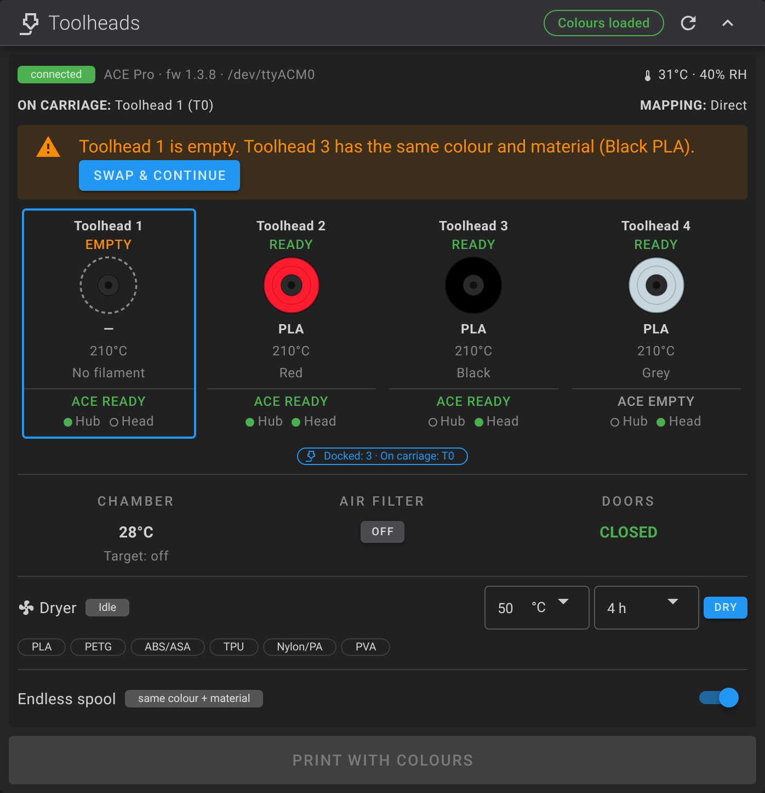 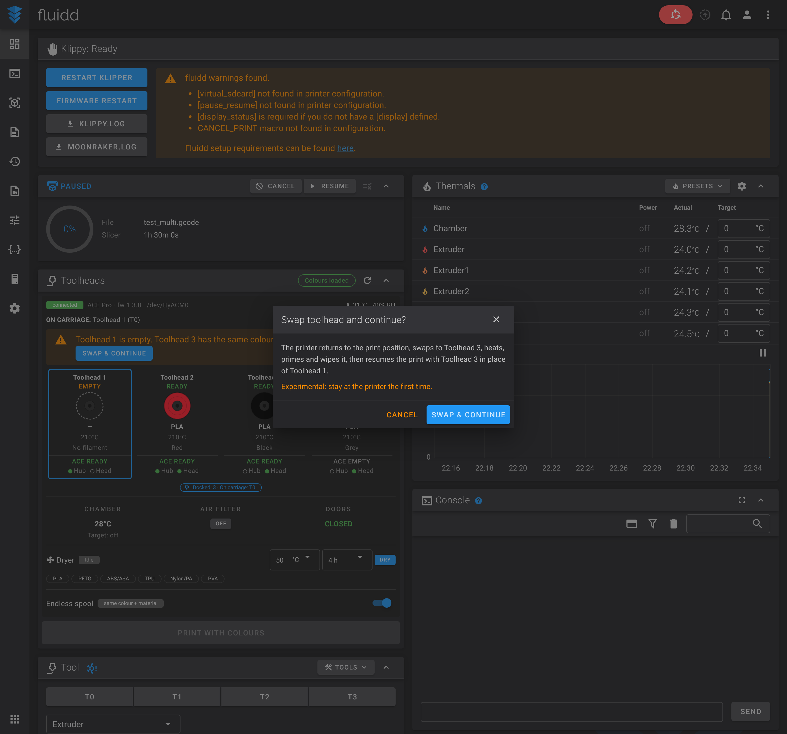<br>
<em>The offer and the one-tap confirmation (demo data).</em>
</div>

Dry run: `WM_ENDLESS_PLAN FROM=0 TO=2` prints what a swap would do and moves nothing. Turn it on with the Fluidd switch or `WM_ENDLESS_SET ENABLE=1`.

**First use:** a cheap print, you at the printer, a hand on the stop button. The pieces are checked in simulation, but the real movement is untested.

---

## 9. Update, undo and uninstall

```
cd ~/wm-ultra-fluidd-acepro-panel && git pull
./installer.sh --update
```

(If you downloaded it without git, see [3.2a](#32a-the-factory-screen-board-no-git-old-clock-archived-apt): download again instead of `git pull`.)

`--update` keeps your tuned distances and speeds. Undo the last install or update with `./installer.sh --undo`. `--uninstall` removes the config files, the include lines and the driver links; WonderMaker's files are never touched. The Fluidd panel is put back by `--undo`.

---

## 10. Troubleshooting

| Problem | Try |
|---|---|
| Installer says "does not look like a WonderMaker ZR Ultra config" | Run it on the machine that has WonderMaker's `zru-s.cfg`, `_CHANGE_TOOL`, `UNLOAD_FILAMENT` and the `path_0` sensor. |
| `--check`: "linked driver is too old" | Update this repository (`git pull`), then run `--repair`. |
| `--check`: broken link | The repository was moved. Run `--repair` from its new place. |
| Klipper: "Unknown config object 'save_variables'" | You installed version 0.2.0, which put the include lines above `[save_variables]`. `git pull` and `./installer.sh --update` (or `--repair`) moves them. |
| Console: "Unknown command WM_SET_TOOL_MAP" (or `WM_STATS_RESET`) | `wm_stats.cfg` is not installed: `git pull`, `./installer.sh --update`, restart Klipper. |
| Klipper: "Unknown config object temperature_ace" or virtual pins | The links in `klippy/extras` are missing: `--repair`. |
| Klipper: T0..T3 behave differently | `register_tool_commands: False` is missing in `wm_ace_driver.cfg` (`--check` reports it). |
| No ACE parts in the Fluidd card | The ACE is not reported yet: restart Klipper, check the USB cable and the ACE power, hard-refresh the browser. |
| ACE not on USB | Data wires only (D+, D-, GND), no 5 V. Check the adapter with a multimeter. |
| Load stops with a timeout | Check `path_N` / `filament<N>` in the card, tube length, then raise the timeouts or `hub_to_head_mm`. |
| Fluidd update in Moonraker removed the panel | `./installer.sh --update`, answer yes to the Fluidd question. |

### 3.5 Fluidd macro categories

At the end of an install or update (after the Klipper restart question) the installer sorts the macros Klipper has loaded into Fluidd's macro categories, so the macro list is not one long row. Run it later, for example after you restarted Klipper, with `./installer.sh --fluidd-categories`.

| Category | Colour | What goes in |
|---|---|---|
| AcePro | red | `ACE_*`, `WM_ENDLESS_*`, `WM_STATS_*`, `WM_SET_TOOL_MAP` |
| Raspberry Pi | blue | the other `WM_*` macros (calibration, nozzle and offsets macros of the Pi installer) |
| WM Ultra Calibration | yellow | WonderMaker's calibration macros (`G29`, `RAPID_MODE`, `CALIBRATE_*`, `SAVE_T_*` ...) |
| WM Ultra Tool Change | green | `T0`..`T3`, `LOCK`, `UNLOCK`, `PARK_CURRENT_TOOL` ... |
| WM Ultra Filament | orange | `LOAD_FILAMENT`, `UNLOAD_FILAMENT`, `WIPE_NOZZLE` ... |
| ZR Tools | purple | `ZR_*` |
| WM Ultra Print | grey | `START_PRINT`, `PRINT_END`, `PAUSE`, `RESUME` ... |
| WM Ultra Tests | dark grey | `TEST_*` |
| Timelapse | cyan | `GET_TIMELAPSE_SETUP`, `HYPERLAPSE`, `TIMELAPSE_*`, `TEST_STREAM_DELAY` |

`M104`, `M106`, `M107`, `M109`, `M141`, `M190`, `M191`, `M221` and `z_rise` are hidden: nobody presses them by hand.

- A category is created only when a macro for it exists (no AcePro category on a printer without the ACE parts), and an existing category with the same name is reused.
- **Your own choices are never changed.** A macro is sorted only while its Fluidd entry is still the default one. A macro you moved, recoloured, renamed or hid is left alone, and every macro is dealt with once: one you unhide or move back later is not touched again. Macros added by a later update are sorted the first time they are seen.
- It needs Moonraker, and Klipper ready, because Klipper is what knows the macros. If Klipper is not running the installer says so and tells you to run `--fluidd-categories` later. It never fails the install.
- The settings Fluidd had before are saved in `~/acepro-backup/fluidd-macros-before-<date>.json`. Uninstalling does not remove the categories (they are your Fluidd settings). Hard-refresh the browser to see the change.

---

## 11. Repository layout

```
wm-ultra-fluidd-acepro-panel/
├── installer.sh                    Installer (install, --update, --check, --repair, --undo, --uninstall, --dry-run)
├── VERSION, CHANGELOG.md           Version and what changed
├── config/
│   ├── wm_ace_driver.cfg           Minimal [ace] driver config (no T0..T7, no cutter, no basket)
│   ├── wm_ace.cfg                  Load / unload / auto-load / feed assist / dryer macros
│   ├── (scripts/ace_hooks.py        adds / checks / removes the 3 hook lines in extruder0..3.cfg)
│   ├── wm_endless.cfg              Experimental endless spool (with the per-head chain)
│   └── wm_stats.cfg                Tool-change counters and the WM_SET_TOOL_MAP macro
├── scripts/wm_fluidd_categories.py Sorts the macros into Fluidd's categories (uses Moonraker's database)
├── extras/                         The ACE driver (linked into klippy/extras by the installer)
│   ├── ace/                        Driver from acepro-any-klipper + the register_tool_commands option
│   ├── virtual_pins.py
│   └── temperature_ace.py
├── fluidd/                         Fluidd 1.37.7 build + patch (Toolheads card with the ACE parts)
├── orca_plugin/                    OrcaSlicer plugin: pick toolheads in Orca
├── docs/                           Hardware notes, ACE USB adapter wiring, screenshots (demo data)
├── tests/                          run_tests.sh (installer), test_macros.py (macros), test_orca_plugin.py, test_fluidd_categories.py
└── LICENSE                         GPL v3
```

The ACE driver in `extras/ace` is a copy of the one in [acepro-any-klipper](https://github.com/ducati1198/acepro-any-klipper) with one small addition: a `register_tool_commands` option (default `True`, so nothing changes elsewhere). The WonderMaker config sets it to `False`.

Run the tests: `bash tests/run_tests.sh`, `python3 -I tests/test_macros.py` (needs `jinja2`) and `python3 -I tests/test_orca_plugin.py`.

---

## 12. Credits and license

Built on:

- The ACE Pro driver and Fluidd work from [ducati1198/acepro-any-klipper](https://github.com/ducati1198/acepro-any-klipper), which builds on [Kobra-S1/ACEPRO](https://github.com/Kobra-S1/ACEPRO), [szkrisz/ACEPROSV08](https://github.com/szkrisz/ACEPROSV08), [utkabobr/DuckACE](https://github.com/utkabobr/DuckACE) and [agrloki/ValgACE](https://github.com/agrloki/ValgACE).
- [Fluidd](https://github.com/fluidd-core/fluidd) v1.37.7.
- WonderMaker's Klipper configuration for the ZR Ultra / Ultra-S (their files are read, never changed).

Config files and Fluidd panel by **ducati1198**.

**License:** GNU General Public License v3.0, see [`LICENSE`](LICENSE).


## Installer menu

Run `./installer.sh` at a terminal (or `./installer.sh --menu`) for a numbered menu (screen shown in the [Quick start](#quick-start)): **1 Install, 2 Update** (See what is new / Update now, works without git), **3 Check and fix** (Check, Repair, Doctor, Support bundle)**, 4 Backup and restore, 5 Dry run, 6 Uninstall, 7 Free up disk space**. Every entry runs the same option as before (`--install`, `--update`, `--check`, `--repair`, `--undo`, `--dry-run`, `--uninstall`), so the options still work for scripts. `--check-updates` shows what is new without downloading; `--get-latest` refreshes the installer folder.
