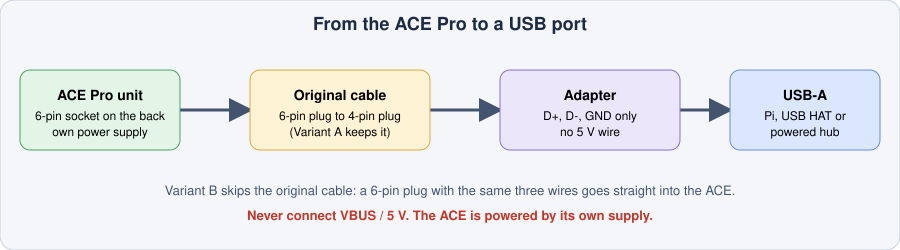
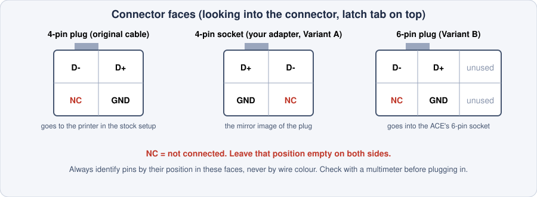

# Hardware and wiring

How to connect an Anycubic ACE Pro to the WonderMaker ZR Ultra / Ultra-S.

> **The pinouts on this page come from the Kobra-S1/ACEPRO documentation and community adapter builds. They are not re-measured on every unit. Check your adapter with a multimeter before plugging it in** (section 3).

## 1. What you need

| Part | Required | Notes |
|---|---|---|
| WonderMaker ZR Ultra / Ultra-S with WonderMaker's Klipper and Moonraker | Yes | |
| 1 Anycubic ACE Pro (first generation, USB) | Yes | One unit covers T0–T3. |
| USB adapter for the ACE | Yes | Section 2. |
| 4 PTFE tubes ACE → hub | Yes | Slot 1 → hub inlet 1 → T0, slot 2 → inlet 2 → T1, slot 3 → inlet 3 → T2, slot 4 → inlet 4 → T3. |

The WonderMaker hub is passive: four filament switches `path_0`…`path_3` on the HUB MCU. The ACE does the pushing and pulling between the ACE and the hub, and WonderMaker's own sensors (`path_N` at the hub, `filament<N>` at each toolhead) are used. No extra sensor is needed.

The ACE has its own power supply. Plug its USB into the Klipper host (a powered USB hub is fine). It shows up as `/dev/ttyACM*`.

The ACE 2 Pro speaks RS-485, not USB, and is not covered here.

## 2. USB adapter for the ACE Pro

<div align="center">

</div>

Only **three wires** are used: **D+, D- and GND**. Do **not** connect VBUS (5 V). A second 5 V source on the data cable can damage the host or the unit.

The stock cable has a 6-pin plug for the ACE and a 4-pin plug that normally goes into an Anycubic printer. You can adapt either end:

| | Variant A: adapt the printer end | Variant B: adapt the ACE end |
|---|---|---|
| Original cable | Kept as it is | Not used |
| You build | A 4-pin socket to USB-A adapter | A 6-pin plug to USB-A cable |
| Donor part | A 4-pin ACE extension cable (cut one end off) | A 6-pin plug or pigtail |

<div align="center">

</div>

| ACE signal | USB-A pin |
|---|---|
| D+ | 3 |
| D- | 2 |
| GND | 4 |
| NC (not connected) | 1 (VBUS) left unconnected |

Use the **position** in the diagram to find each pin; wire colours differ between cable makers.

## 3. Check before you plug in

With a multimeter (no ACE connected, nothing powered):

1. **Continuity:** D+ to USB pin 3, D- to USB pin 2, GND to USB pin 4.
2. **No shorts:** D+ to D-, D+ to GND and D- to GND must not beep.
3. **VBUS:** USB pin 1 must not be connected to anything on the ACE side.

Then plug it in, power the ACE, and on the machine that runs Klipper:

```bash
ls /dev/serial/by-id/          # the ACE should be listed
```

After Klipper has restarted, the ACE chip in the Fluidd Toolheads card shows "connected".

## 4. Ready-made adapters and references

- Printable adapter: <https://www.printables.com/model/1163780-anycubic-ace-pro-usb-a-adapter>
- Printable USB-C back cover: <https://www.printables.com/model/1227630-anycubic-acepro-back-cover-for-usb-c>
- Pinout and adapter documentation: [Kobra-S1/ACEPRO](https://github.com/Kobra-S1/ACEPRO)
