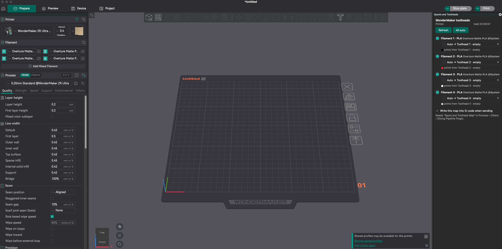

# WM Toolhead Mapper: OrcaSlicer 2.5 plugin

> **New: one plugin for both printers.** [`spool_toolhead_mapper.py`](spool_toolhead_mapper.py) combines the ACE Spool Mapper (ACE Pro, acepro-any-klipper) and the WM Toolhead Mapper (WonderMaker ZR Ultra-S). It asks the printer (Moonraker) what it is: a printer with the `ace` object gets the ACE panel and `ACE_SET_TOOL_MAP`; a printer with the WonderMaker `filament0..3` sensors gets the toolhead panel and `WM_SET_TOOL_MAP`; any other printer is left alone (nothing is written into its G-code). Install it the same way as below (**Install local plugin**), enable its two parts (**Spools and Toolheads** and **Spool and Toolhead Map**), add **Spool and Toolhead Map** in Process > Others > Slicing Pipeline Plugin, and remove the older plugin first so the line is not written twice. It uses the print host of each printer preset, so set that on every printer preset. Not yet tested inside OrcaSlicer (the helper code is tested against both old plugins with fake printers).




> **Not yet tested in OrcaSlicer or on a printer.** Adapted from the ACE Spool Mapper plugin of
> [acepro-any-klipper](https://github.com/ducati1198/acepro-any-klipper). Use at your own risk (see the main README).

Pick which WonderMaker toolhead prints each OrcaSlicer filament, right in Orca. Works with **Upload and Print**,
**Upload** and **Export G-code**. It does the same job as the "Choose toolheads" window in Fluidd, but before the
file reaches the printer.

## Needs

- OrcaSlicer 2.5 or newer (plugin system).
- `wm_stats.cfg` on the printer (installed by `./installer.sh`; it holds the `WM_SET_TOOL_MAP` macro).
- The printer preset's host set to your printer (Printer settings → Connection), e.g. `192.168.0.50:7125`.

## Install (once)

1. In OrcaSlicer open **File → Plugins**.
2. **Browse plugins** (split button) → **Install local plugin** → pick `wm_toolhead_mapper.py`.
3. Orca asks once whether the plugin may connect to your printer: click **Yes**.
4. The plugin brings two parts: **WM Toolheads** (the panel) and **WM Tool Map** (the G-code step). Enable both.
5. Turn on the G-code step: switch Orca to **Advanced** mode, open your **Process** settings → **Others** →
   **Slicing Pipeline Plugin**, add **WM Tool Map**, save the process preset (for each process preset you print with).
6. Restart Orca. The **WM Toolheads** panel docks on the right of the 3D view.

## Use

1. In the panel, each project filament shows its best toolhead (**Auto →**: same material, closest colour, each
   toolhead once). Change any row to a specific toolhead or **As sliced**. The toolheads' colours and materials are
   the ones saved on the printer (the touchscreen / Fluidd Toolheads card); empty toolheads cannot be picked.
2. Slice and use **Upload and Print** (or Upload / Export). Sending never opens a window, so set the toolheads in
   the panel first.

The G-code gets two lines before the start G-code:

```
; WM Toolhead Mapper: T0 as sliced, T1->Toolhead 4 PETG
WM_SET_TOOL_MAP MAP=0:0,1:3,2:2,3:3 FILE="benchy.gcode" KEEP_EXISTING=1
```

Print tool T1 is then printed with toolhead 4. Toolhead numbers in the macro start at 0.

## Good to know

- The whole map is written every time, so a map from an earlier print is never reused.
- If the panel has no data and the printer cannot be reached, the file prints as sliced (`0:0,1:1,2:2,3:3`).
- If you start the same file from Fluidd and choose toolheads in its "Choose toolheads" window, the Fluidd choice
  wins (`KEEP_EXISTING=1` and the saved `wm_map_file`).
- Orca's preview shows the G-code before the plugin step; the inserted lines are only in the sent file.
